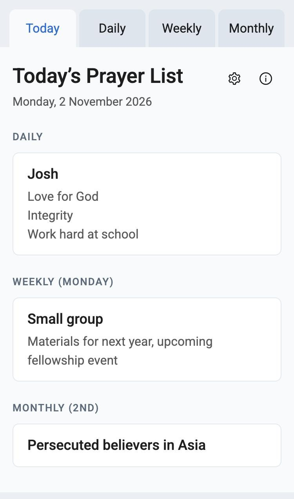
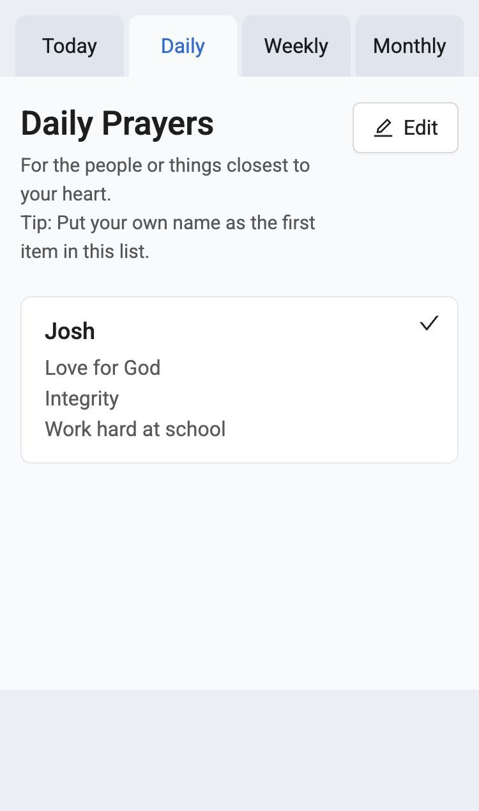
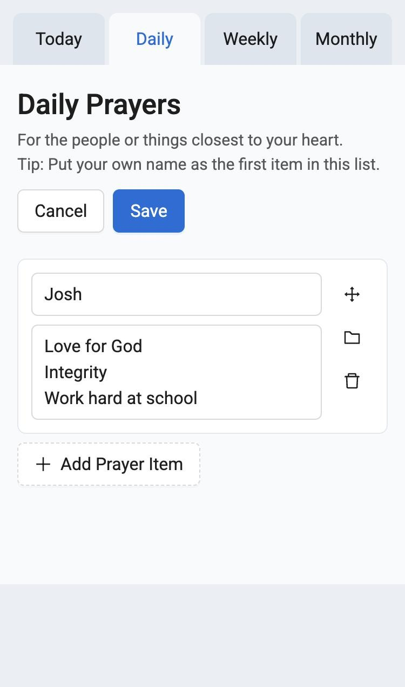
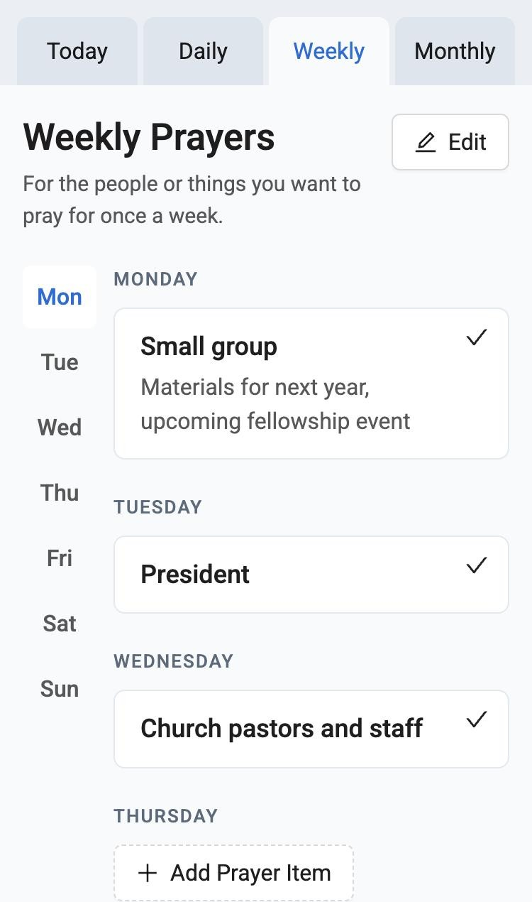
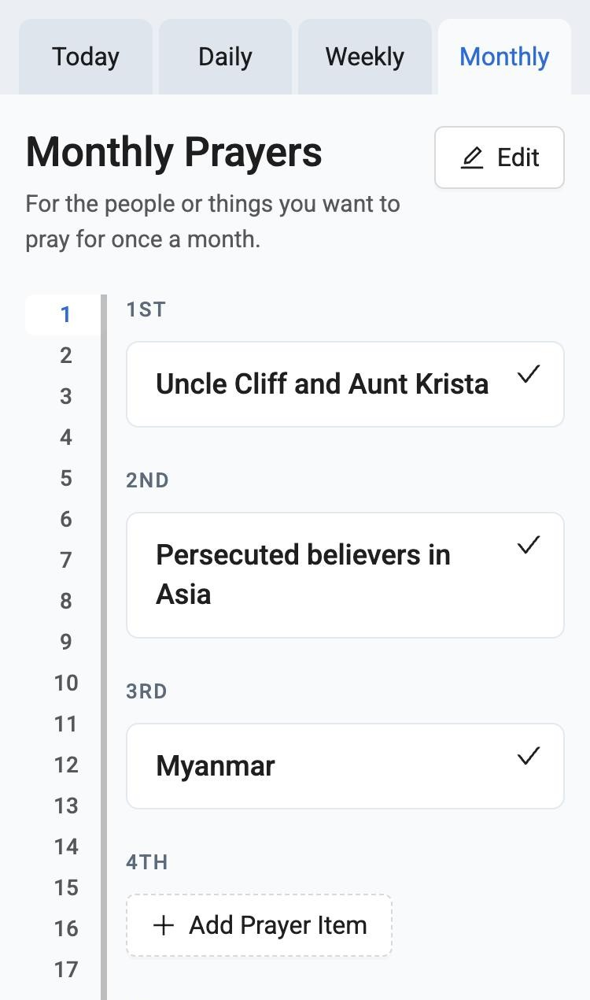

# Prayer Notebook

A simple, serverless tool to list down daily, weekly and monthly requests.

> "And pray in the Spirit on all occasions with all kinds of prayers and requests." — Ephesians 6:18

This prayer notebook is inspired by _MasterLife Together_ by Matt & Allison Willis.

<table>
  <tr>
    <td align="center"> <b>Today</b></td>
    <td align="center"> <b>Daily</b></td>
    <td align="center"> <b>Editing</b></td>
  </tr>
  <tr>
    <td align="center"> <b>Weekly</b></td>
    <td align="center"> <b>Monthly</b></td>
    <td></td>
  </tr>
</table>

## What it does

Keep your prayer requests in three lists, then open **Today** each day to see everything you planned to pray for.

- **Daily**: for the people or things closest to your heart.
- **Weekly**: for the people or things you want to pray for once a week.
- **Monthly**: for the people or things you want to pray for once a month.
- **Today**: shows your Daily list, today's weekday from Weekly, and today's date from Monthly. On the last day of a shorter month it also includes dates up to the 31st, so nothing is skipped.
- **Answered**: tick a prayer to mark it as answered, and add an optional note such as the date or a Bible verse. Answered prayers are kept as a record of God's faithfulness.

**Editing.** Press **Edit** to change a list. Add items, reorder them with the drag handle (or the up and down arrow keys), move an item to another list, or delete it. Nothing is saved until you press **Save**, and **Cancel** discards your changes.

## On your phone

The layout is designed for phones as well as desktops, and the app can be installed on your home screen so it opens like a normal app and keeps working offline. 

In Chrome on Android, open the site and choose **Install app** (or **Add to Home screen**) from the browser menu.

## Settings

Tap the gear icon on the Today tab to:

- Choose a font: Roboto, Nunito, Lora, Kalam, Shadows Into Light or Nanum Pen Script.
- Choose a text size: S, M, L or XL.
- **Export** your prayers and settings (copied to your clipboard), and **Import** them again in another browser or on another device. Importing replaces everything currently saved.
- **Clear All Data** to wipe everything from your browser.

## Privacy

All data is saved in your local browser. No data is sent to a server.

This also means your prayers live in one browser on one device. Use Export and Import to move them, or to keep a backup. Clearing your browser's site data will delete them.

## Tips

- This tool is intended for daily use. You can be in any position when praying: kneeling, laying, sitting, standing, walking.
- Make time to ask people you pray for daily what they would like you to be praying about.
- Ask God what He wants you to pray for.
